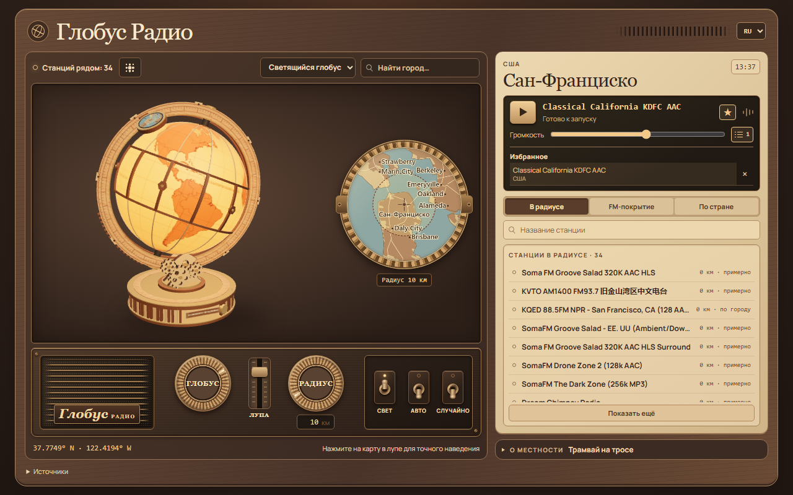
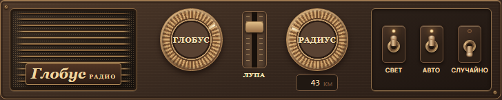
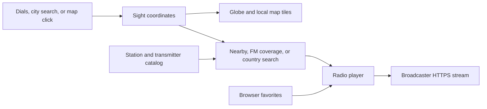
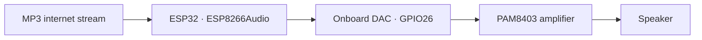

# Globus Radio

[Русский](README.md) · English

[Open in the Laboratory](https://androman.pro/labs/globus-radio/?lang=en) · [Full-page receiver](https://androman.pro/apps/globus-radio/?lang=en)

Turn the globe, aim the magnifier at a city, and listen to local radio. Globus Radio is a browser-based receiver with a wooden globe, moving gears, and internet radio from around the world.



## Try it

| Example | What to do |
| --- | --- |
| **Listen to a city** | Search for San Francisco or London. Choose a station and press ▶. The search radius starts at 10 km. |
| **Find a station at random** | Press the Random switch or the dice icon. The globe slows down over the chosen station and the receiver tries its stream. |
| **Build a favorites list** | Click the star next to a station name. Open the list beside the volume control to play saved stations from anywhere on the globe. |
| **Explore the map** | Choose Satellite or Radio atlas and zoom in to reveal towns, roads, rivers, and built-up areas. |
| **Compare station density** | Toggle the heat map to see where the catalog has more stations with local coordinates. |



### Four views of Earth

- **Illuminated globe** — a wooden model, a magnifying lens, dials, and toggle switches. Auto-rotate starts after 12 seconds of inactivity when enabled.
- **Radio atlas** — a paper-style map with a scale and map legend. [Screenshot](docs/radio-globe-heat-map-preview.png)
- **Night broadcast** — city lights and a procedural aurora. [Screenshot](docs/radio-globe-night-preview.png)
- **Satellite** — NASA terrain imagery with animated procedural clouds. [Screenshot](docs/radio-globe-satellite-clouds-preview.png)

## How it works



Nearby search uses station coordinates. FM search uses published reception contours or estimated transmitter ranges. In either mode, the selected station plays over the internet. Country search supplements the local catalog through Radio Browser. The maps and local catalog ship with the app. [Sources and attribution](docs/data-sources.md)

The browser saves favorites, language, and theme. Stream availability depends on the broadcaster. If your browser blocks automatic playback, press ▶.

## Run locally

Use Node.js 20.19+ or 22.12+.

```sh
cd emulator
npm ci
npm run dev
```

Open the [local emulator](http://127.0.0.1:4173/). The illuminated globe and 3D effects use WebGL. The radio atlas can also render in Canvas.

For static hosting, run `npm run build` from `emulator` and copy **the entire contents of `emulator/dist/`** to the site root or a subdirectory. The build uses relative asset URLs. To preview the production build locally, stop the dev server and run `npm run preview`.

## Physical globe

The [3D model](docs/radio-globe-vintage.glb) shows a wooden receiver with a magnifying lens and visible gears. It is a mechanical concept. The [ESP32 sketch](firmware/globus_radio/) tests MP3 streaming separately. Two AS5600 magnetic encoders and position-based tuning are planned hardware work.



In Arduino IDE, choose **ESP32 Dev Module**, install **ESP8266Audio**, and copy `wifi_secrets.example.h` to `wifi_secrets.h`. Enter your Wi-Fi settings in that copy. Set the Serial Monitor to 115200 baud. Use `n` and `p` to change streams and `+` and `-` to adjust the volume.

## License

The project code is released under the MIT License. Maps, textures, catalogs, and dependencies retain their providers’ terms. [MIT License](LICENSE) · [Sources and attribution](docs/data-sources.md)
