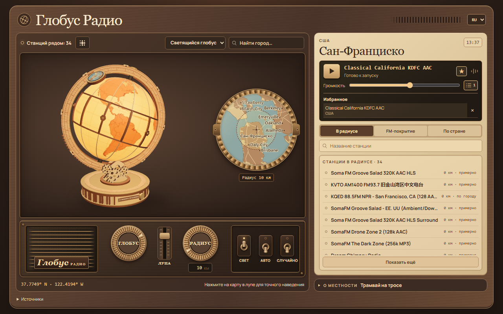
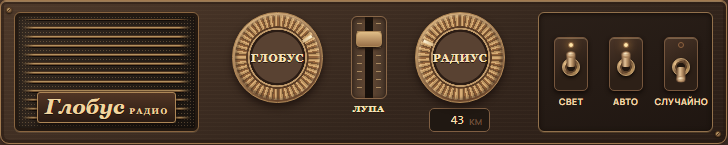
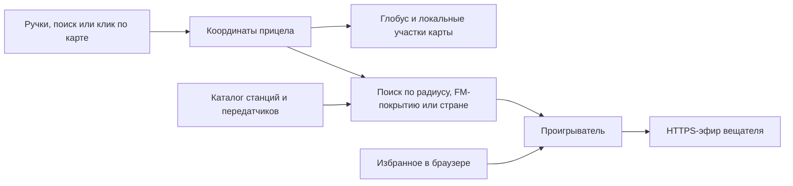

# Глобус Радио

Русский · [English](README.en.md)

[Открыть в Лаборатории](https://androman.pro/labs/globus-radio/) · [Приёмник на весь экран](https://androman.pro/apps/globus-radio/)

Поверните глобус, наведите лупу на город и включите местное радио. Глобус Радио — браузерный приёмник с деревянным шаром, движущимися шестернями и интернет-эфиром со всего мира.



## Что попробовать

| Сценарий | Как запустить |
| --- | --- |
| **Послушать город** | Найдите Сан-Франциско или Лондон через поиск. Выберите станцию в списке и нажмите ▶. Радиус поиска начинается с 10 км. |
| **Найти эфир наугад** | Нажмите «Случайно» или пиктограмму игральной кости. Шар замедлится над выбранной станцией и приёмник попробует включить поток. |
| **Собрать избранное** | Нажмите звёздочку рядом с названием станции. Список рядом с громкостью откроет сохранённые станции. Их можно включать из любой точки глобуса. |
| **Рассмотреть местность** | Выберите «Спутниковый» или «Радиоатлас» и приблизьте карту. На детальных масштабах появляются населённые пункты, дороги, реки и контуры застройки. |
| **Сравнить плотность станций** | Включите теплокарту. Цвет показывает плотность локальных позиций в каталоге. |



### Четыре вида Земли

- **Светящийся глобус** — деревянная модель, лупа, механические ручки и тумблеры. Автовращение можно включить, чтобы шар начал вращаться через 12 секунд бездействия.
- **Радиоатлас** — картография на бумажной подложке с масштабом и легендой. [Скриншот](docs/radio-globe-heat-map-preview.png)
- **Ночной эфир** — огни городов и процедурное полярное сияние. [Скриншот](docs/radio-globe-night-preview.png)
- **Спутниковый** — рельеф Земли на снимке NASA и движущиеся процедурные облака. [Скриншот](docs/radio-globe-satellite-clouds-preview.png)

## Как это работает



Поиск по радиусу смотрит на координаты станций. Режим FM использует опубликованные контуры или расчётную дальность передатчиков. Выбранный эфир в обоих случаях поступает из интернета. Поиск по стране дополняет локальный каталог через Radio Browser. Карта и локальный каталог входят в сборку. [Источники и атрибуция](docs/data-sources.md)

Браузер сохраняет избранное, язык и тему. Доступность отдельных эфиров зависит от вещателя. Если браузер блокирует автоматический запуск, нажмите ▶.

## Запуск

Понадобится Node.js 20.19+ или 22.12+.

```sh
cd emulator
npm ci
npm run dev
```

Откройте [локальный эмулятор](http://127.0.0.1:4173/). Светящаяся модель и объёмные эффекты используют WebGL. Радиоатлас доступен при программной отрисовке Canvas.

Для статического хостинга выполните `npm run build` в папке `emulator` и разместите **всё содержимое `emulator/dist/`** в корне сайта или в подпапке. Сборка использует относительные адреса ресурсов. Для локальной проверки собранного варианта закройте сервер разработки и выполните `npm run preview`.

## Физический глобус

В [3D-модели](docs/radio-globe-vintage.glb) показан корпус деревянного приёмника с лупой и шестернями. Это концепт механики. [Прошивка ESP32](firmware/globus_radio/) отдельно проверяет воспроизведение MP3-потока. Два магнитных энкодера AS5600 и привязка эфира к углам относятся к следующему этапу.


Для запуска прошивки в Arduino IDE выберите **ESP32 Dev Module**, установите библиотеку **ESP8266Audio** и скопируйте `wifi_secrets.example.h` в `wifi_secrets.h`. Укажите в своей копии параметры Wi‑Fi. Для Serial Monitor установите 115200 бод. Команды `n` и `p` переключают станции, `+` и `-` меняют громкость.

## Лицензия

Код проекта распространяется по MIT. Картографические данные, текстуры, каталоги и библиотечные зависимости сохраняют условия своих поставщиков. [Лицензия MIT](LICENSE) · [Источники и атрибуция](docs/data-sources.md)
